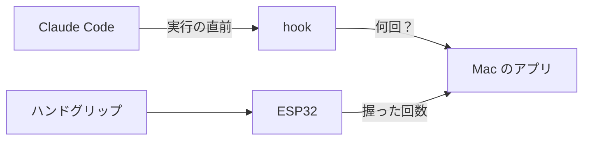
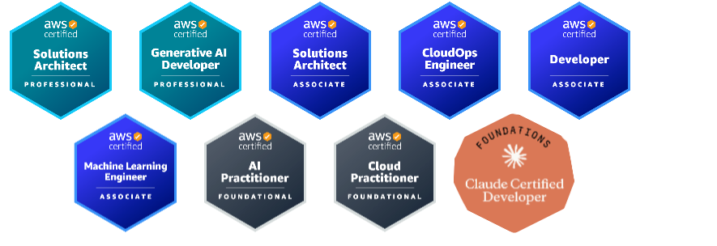

# Claude Code の承認を、<br>握力に任せた話。

筋肉エンジニアのLT会 × LT道場 / はすと

<!--
（5秒）Claude Code の承認を、握力に任せる仕組みを作ったので紹介します。
-->

---
layout: center
---

# Claude Code、こう聞いてきますよね

【画像】Claude Code がコマンドの実行を確認してくる画面

<v-click>

<div class="text-2xl mt-8">

`pnpm test` も `rm -rf build` も、**同じ Enter 1回**で通る

</div>

</v-click>

<!--
（25秒）Claude Code はコマンドを実行するたびに、実行していいか聞いてきます。最初はちゃんと読むんですが、何十回も聞かれると、読まずに Enter を押すようになります。
[click] pnpm test も rm -rf も、同じ Enter 1回で通ってしまう。承認疲れってやつです。
-->

---
layout: center
---

# 承認に「重さ」をつける

| 頼まれた操作 | 必要な回数 |
|---|---|
| `rm -rf`・`git push -f`・`sudo` など | **50回** |
| それ以外のコマンド | 10回 |
| ファイルの編集 | 5回 |
| ファイルを読むだけ | 0回 |

<div class="mt-6 text-xl">危ない操作ほど、ハンドグリップを多く握らないと通らない</div>

<!--
（20秒）そこで、承認に重さをつけました。ハンドグリップを決められた回数握らないと、コマンドが実行されません。危ない操作ほど回数が増えて、rm -rf は50回です。
-->

---

# 作ったもの

【画像】ハンドグリップ + ESP32 + 電池ボックスの全体写真

- ハンドルの内側にアルミホイル。握り切ると GPIO4 と GND がつながる
- ESP32 は単3電池で動き、握った回数を BLE で Mac に送るだけ
- はんだ付けなし

<!--
（20秒）作ったのがこれです。ハンドルの内側にアルミホイルを貼っていて、握り切るとホイル同士が触れて、ESP32 が1回と数えます。ESP32 は電池で動いていて、回数を BLE で Mac に送ります。はんだ付けはしていません。
-->

---

# 仕組み



Claude Code の **PreToolUse hook** が、実行するかどうかを `allow` / `deny` で返す

<!--
（25秒）Claude Code には、ツールを実行する直前に呼ばれる hook という仕組みがあります。hook が Mac のアプリに「何回握ればいいか」を伝えて待ち、ESP32 から届く回数が足りたら allow、時間切れなら deny を返します。
-->

---
layout: center
---

# デモ

`rm -rf build` → 50回

【画像】スピナーに「💪 ハンドグリップを50回握ってください」と出ている画面

<!--
（90秒）ライブデモ。
事前準備：デモのセッションは /model で速いモデル（Sonnet など）にしておく。pnpm test の1往復に49秒かかったため。
1. 「rm -rf build を実行して」と頼む → スピナーに「50回握ってください」と出る
2. 握る → 途中で力尽きる → 拒否の音
3. Claude に「握力が足りませんでした（○/50回）」と返っているのを見せる
うまく動かなかったら、録画しておいた動画に切り替える。
-->

---
layout: center
---

# 力尽きると、Claude に理由が返る

```text
握力が足りませんでした（23/50回）
```

【画像】デモで拒否されたときの Claude Code の画面

<!--
（15秒）時間内に握り切れないと、Claude には握れた回数つきで拒否が返ります。Claude からも、こちらの握力が見えています。
（数字はデモの結果に合わせる）
-->

---
layout: center
---

# 50回握り切ったら？

<v-click>

`settings.json` の拒否ルールは、hook が `allow` を返しても評価される

```json
"deny": ["Bash(rm -rf /)", "Bash(rm -rf ~)"]
```

**`rm -rf /` は握力では通せない**

</v-click>

<!--
（20秒）じゃあ鍛えて50回握り切れば、何でも通るのか。
[click] 公式ドキュメントに、拒否ルールは hook が何を返しても評価されると書いてあります。なので rm -rf / は、どれだけ握力があっても通りません。
-->

---

# 作ってみて想定外だったこと

- 手元の電池が角型 9V しかなく、いったん USB で作った
  - → Mac でポートを開き直すと、古い行が延々と届くことがある
- 単3電池で BLE に戻したら、ESP32 が見つからなくなった
  - → 接続の途中で止まると、ESP32 が接続中のまま電波を止める。各手順に時間切れを付けた

【画像】メニューバーの「💪 23/50 41s」

<!--
（30秒）想定外が2つありました。1つ目、電池が角型の 9V しかなく、いったん USB で作ったら、ポートを開き直すと古い行が延々と届きました。2つ目、単3電池で BLE に戻したら、接続の途中で止まったときに ESP32 が電波を止めて、見つからなくなりました。
-->

---
layout: center
---

# まとめ

承認に**重さ**をつけると、`rm -rf` の前に一度考える

<div class="mt-8">

github.com/HasutoSasaki/grip-approver

</div>

<!--
（15秒）承認に重さをつけると、rm -rf を頼む前に一度考えるきっかけになります。コードは GitHub に置いています。
-->

---

# 自己紹介

<div class="grid grid-cols-[13rem_auto] gap-x-14 gap-y-8 mt-4 items-center w-fit mx-auto">

<div class="text-xl leading-loose">

- **佐々木 蓮斗**（ささき はすと）
- 製造ビジネステクノロジー部
- サーバーサイドエンジニア
- 社内 LT 会「**LT道場**」を運営
- 趣味：筋トレ、アニメ
    - 最近ベンチ100kg達成しました

</div>

</div>

<!--
（10秒）最後に自己紹介です。クラスメソッドのはすとです。LT道場の運営をしていて、筋トレが趣味です。最近ベンチプレス100kgを達成しました。ありがとうございました。
-->
