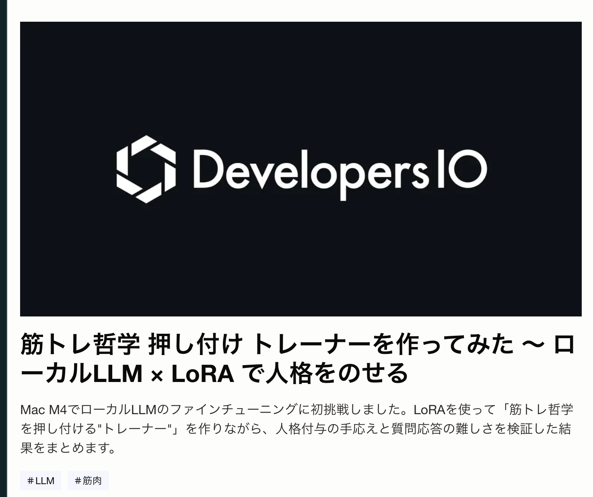

# AI時代こそ、趣味を極める

技術の勉強より大切なこと

  @HasutoSasaki

<!--
- AI時代にエンジニアとして何が価値になるか、という話をする
-->

---

<ProfileCard />

<!--
- Sasaki Hasuto です
- classmethod で Web アプリ開発をしています
-->

---
layout: statement
---

# 土日・仕事終わり
# 何してますか？

<!--
- まずこれを聞いてみたい
-->

---

## エンジニアあるある

  
技術書を読む

  
個人開発する

  
資格の勉強をする

<!--
- 技術書・個人開発・資格勉強、これはよく聞く
-->

---

## なぜ勉強する？

  
AIが進化して、仕事が奪われるのでは…

  
だから勉強する、技術に触れる

<!--
- 不安から技術を磨こうとする、これもエンジニアあるある
- でもそこで私は別の考えに至った
-->

---
layout: statement
---

# だがしかし、

<!--
- これが今日の提案
-->

---
layout: statement
---

# 趣味に全振りしましょう🎉

<!--
- これが今日の提案
-->

---

## きっかけ

  
ファインチューニングで筋トレ哲学トレーナーを作ろうとした

  
→口調や情報は載せられた

  
しかし、経験則からくる知識って載せれる？

  
  
dev.classmethod.jp/articles/muscle-philosophy-trainer-lora/

<!--
- LoRAの限界ではなく、経験則は載せにくいという気づき
-->

---

## 例えば、伝統工芸の話

  
継承者不足で失われていく職人技がある

  
AIに記録・継承できないか？

  
職人の技は経験則の塊、学習データにしきれない部分が残る

<!--
- 経験則が載せにくいのは筋トレに限った話ではない
-->

---
layout: statement
---

# 経験こそが
# 最大の価値になるのでは？

<!--
- 職人技も、筋トレも、共通する結論
-->

---

## 筋トレで言うと(趣味)

  
情報や知識はAIに載せられる

  
フォームも、消費カロリーも、なんでも教えてくれる

  
でも、あなたに合ったトレーニングは？

<!--
- 情報はAIで得られる
- でもそこから先に疑問が生まれた
-->

---

## 個人に最適なトレーニングは、AIには出せない

  
体格、生活リズム、性別、年齢……

  
正解は自分の経験からしか出てこない

  
身体で積み上げた知見は、AIには真似できない

<!--
- 個人の情報をすべてAIに載せるのは不可能
- 経験に基づく知見こそが、代替されない価値
-->

---

## 何が求められる？

  
情報があふれる世界で、求められるのは

  
→特定の課題/問題にフィットするもの

  
でもそれは経験の浅い人には作れない

  
→趣味を極めることが、残り続ける策になるのでは

<!--
- 経験の深さがその人だけの答えを作る
-->

---

## ではどうしていくか

  
知識を蓄えていくだけなら、AIが補完してくれる

  
残るのは「深い人」としての価値

  
趣味こそがその深さを作ってくれる！（はず

<!--
- エンジニア文脈に引き戻す
- 技術の話はAIに任せて、深さを育てる
-->

---
layout: statement
---

# あなたは趣味全振り派？
# それとも技術を極める派？

<!--
- 自分の考えを話したが、皆さんはどちら派か聞きたい
-->

---
layout: statement
---

# ご清聴ありがとうございました

---

## 参考

- [Tacit Knowledge Is Your Next Competitive Moat — California Management Review (2026)](https://cmr.berkeley.edu/2026/03/tacit-knowledge-is-your-next-competitive-moat/)
- [AI時代の技術伝承：製造現場の暗黙知をどう引き継ぐか？ — コベルコシステム](https://www.kobelcosys.co.jp/column/monozukuri/20251101/)
- [Digitizing Tacit Knowledge — HAKO](https://www.hako.soooul.xyz/media/digitizing-tacit-knowledge)

