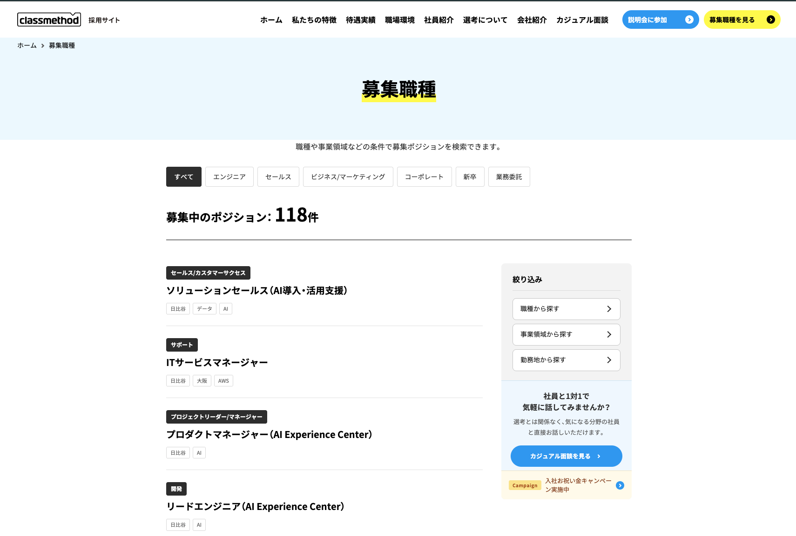
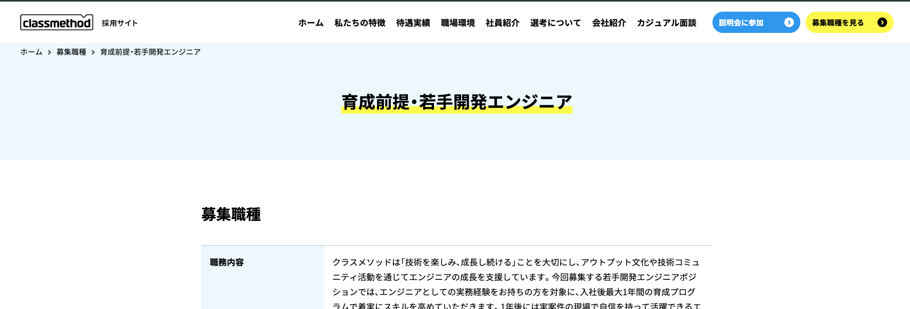

# 筋トレ哲学 押し付け トレーナーを作ってみた

ローカルLLM × LoRA で人格をのせる

<div class="absolute bottom-10">
  <span class="font-700">
    @HasutoSasaki
  </span>
</div>

<!--
- Mac M4 16GB で、ローカルLLMにLoRAで「押し付け筋トレトレーナー」の人格を焼き込んだ話をします
- 機械学習って難しそう、時間かかりそう、と思ってる方こそ最後まで聞いてもらえると嬉しいです
-->

---

<ProfileCard />

<!--
- Hasuto です。2026年1月からクラスメソッドでサーバーサイドを書いています
- 趣味は筋トレで、今日のネタにもガッツリ反映されています
-->

---

<p class="!text-sm font-600 tracking-wide text-blue-600 !m-0 !mb-1"><carbon:help class="inline mr-1" />ちょっと聞かせてください</p>

# みなさんへ質問

<div class="mt-12 space-y-6">

<div class="bg-black/5 p-5 rounded-xl border border-black/10 shadow-sm">
<p class="!text-2xl !m-0 leading-relaxed font-bold">AI を使ったことが <span class="text-blue-600">ない</span> 方？</p>
</div>

<div v-click class="bg-black/5 p-5 rounded-xl border border-black/10 shadow-sm">
<p class="!text-2xl !m-0 leading-relaxed font-bold">Local LLM を <span class="text-blue-600">触ったこと</span> がある方？</p>
</div>

<div v-click class="bg-black/5 p-5 rounded-xl border border-black/10 shadow-sm relative">
<p class="!text-2xl !m-0 leading-relaxed font-bold"><span class="text-blue-600">ファインチューニング</span> したことがある方？</p>

<div v-click class="absolute -right-3 -top-3 flex items-center gap-2 bg-red-500/10 px-4 py-2 rounded-full border-2 border-red-500/60 shadow-md transform rotate-3">
<carbon:close-large class="text-red-500 text-2xl" />
<span class="!text-lg font-bold text-red-500">私もありません</span>
</div>
</div>

</div>

<!--
- ここでちょっと会場の温度感を聞かせてください
- まず、AI を使ったことがない方？　（ほぼいないですよね）
- 次に、Local LLM を触ったことがある方？　（手を挙げてもらう）
- 最後に、ファインチューニングしたことがある方？　（さらに絞られるはず）
- そして…実は私もファインチューニングしたことありません！（バッジを出す）
- 今日は私みたいに「これからやってみたい」人にも届く話にします
-->

---

<p class="!text-sm font-600 tracking-wide text-blue-600 !m-0 !mb-1"><carbon:flash class="inline mr-1" />でも今回</p>

# Local LLM Meetup、ちょうどいい機会

<div class="mt-10">

<p class="!text-2xl !m-0 leading-relaxed">入門するいい機会だ。<span class="opacity-70">何を作ろう…？</span></p>

<div v-click class="mt-10 bg-blue-500/10 p-6 rounded-xl border border-blue-500/30">
<p class="!text-sm font-600 tracking-wide text-blue-600 !m-0 !mb-2"><carbon:idea class="inline mr-1" />ひらめき</p>
<p class="!text-2xl !m-0 leading-relaxed font-bold">「自分の筋トレ哲学を押し付けてくる LLM、<br>おもろいのでは…？」</p>
</div>

<p v-click class="!text-xl !mt-10 !m-0 text-center opacity-80">→ ファインチューニングで遊んでみた</p>

</div>

<!--
- そんな中、今回 Local LLM Meetup の登壇機会があって、これはちょうどいい入門のきっかけだなと思いました
- 何を作ろうかなって考えた結果、ひらめいたのがこれです
- 「自分の筋トレ哲学を押し付けてくる LLM、おもろいのでは…？」
- そんなノリで、ファインチューニングで遊んでみた、というのが今日の話です
-->

---
hide: true
---

<p class="!text-sm font-600 tracking-wide text-blue-600 !m-0 !mb-1"><carbon:warning class="inline mr-1" />登壇前の私</p>

# 私の事前知識、こんなもん

<div class="mt-10">

<p class="!text-2xl !m-0 leading-relaxed">「ファインチューニングしてみたい」と思ったが…</p>

<div class="mt-6 grid grid-cols-3 gap-4">

<div class="bg-black/5 p-5 rounded-xl border border-black/10 shadow-sm">
<p class="!text-sm font-600 tracking-wide text-blue-600 !m-0 !mb-2"><carbon:machine-learning-model class="inline mr-1" />Local LLM</p>
<p class="!text-xl font-bold !m-0 leading-relaxed">Llama / Qwen</p>
<p class="!text-base !mt-2 !m-0 opacity-70">名前を知っているくらい</p>
</div>

<div class="bg-black/5 p-5 rounded-xl border border-black/10 shadow-sm">
<p class="!text-sm font-600 tracking-wide text-blue-600 !m-0 !mb-2"><carbon:book class="inline mr-1" />AI 用語</p>
<p class="!text-xl font-bold !m-0 leading-relaxed">AWS AIF レベル</p>
<p class="!text-base !mt-2 !m-0 opacity-70">資格勉強で<br>用語を撫でた程度</p>
</div>

<div class="bg-black/5 p-5 rounded-xl border border-black/10 shadow-sm">
<p class="!text-sm font-600 tracking-wide text-blue-600 !m-0 !mb-2"><carbon:tools class="inline mr-1" />ファインチューニング</p>
<p class="!text-xl font-bold !m-0 leading-relaxed">未経験</p>
<p class="!text-base !mt-2 !m-0 opacity-70">手を動かしたことなし</p>
</div>

</div>

<p v-click class="!text-2xl !mt-12 !m-0 text-center font-bold">
    　しかし、
  <span v-mark.underline.blue="2" class="text-blue-600">始めるのは</span>、想像よりラクだった
</p>

</div>

<!--
- 「ファインチューニングしてみたい」と思って自分から登壇に応募しましたが、私の事前知識はこのレベルでした
- Local LLM は Llama・Qwen の名前を知っているくらい、内部の話は分かってない
- AI 用語は AWS の AI Practitioner（AIF）の資格勉強で用語を撫でた程度
- ファインチューニングは未経験、手を動かしたこともなかった
- このレベルから始めても、「始めるのは想像よりずっとラク」でした
- 「あくまで始めるのは」というのが今日の話のキーワードで、最後の「とりあえず試して」で回収します
-->

---

# 今回作ったもの

<div class="mt-8 grid grid-cols-[1fr_auto] gap-10 items-center">

<div>
<p class="!text-2xl !m-0 leading-relaxed font-bold">自分の筋トレ哲学を押し付けてくるトレーナー 💪</p>
<p class="!text-lg !mt-6 !m-0 opacity-60">中立的な解説モデルが、<br>"だ・である調" の押し付けキャラに変身</p>
</div>

<div class="bg-black/5 p-6 rounded-xl border border-black/10 shadow-sm max-w-md">
<p class="!text-sm font-600 tracking-wide text-blue-600 !m-0 !mb-3"><carbon:chat class="inline mr-1" />会話例（実際の出力）</p>
<p class="!text-lg !m-0 opacity-60">You> 胸トレ何やればいい？</p>
<p class="!text-base !mt-3 !m-0 font-bold leading-relaxed">Trainer> ベンチプレスで胸を鍛えるには、まずベンチプレスを極めてこなせ。ベンチプレスを極めてこなせば、胸を鍛えることに繋がる。</p>
<p class="!text-base !mt-3 !m-0 opacity-50">temp=0.5 / seed=42（本日のデモ条件）</p>
</div>

</div>

<!--
- 作ったのは「押し付けてくる筋トレトレーナー」
- ベースは中立的に解説してくれるLLMだったのを、LoRAで「だ・である調の押し付けキャラ」に変身させました
- 私は筋トレが趣味なので、自分の哲学を学習データに使いました
-->

---

<p class="!text-sm font-600 tracking-wide text-blue-600 !m-0 !mb-1"><carbon:cube class="inline mr-1" />素材</p>

# Mac 1台で完結

<div class="mt-8 grid grid-cols-3 gap-4">

<div class="bg-black/5 p-5 rounded-xl border border-black/10 shadow-sm">
<p class="!text-sm font-600 tracking-wide text-blue-600 !m-0 !mb-2"><carbon:laptop class="inline mr-1" />マシン</p>
<p class="!text-xl font-bold !m-0">Mac M4</p>
<p class="!text-base !mt-1 !m-0 opacity-70">16GB Unified Memory</p>
</div>

<div class="bg-black/5 p-5 rounded-xl border border-black/10 shadow-sm">
<p class="!text-sm font-600 tracking-wide text-blue-600 !m-0 !mb-2"><carbon:tool-kit class="inline mr-1" />ツール</p>
<p class="!text-xl font-bold !m-0">mlx-lm</p>
<p class="!text-base !mt-1 !m-0 opacity-70">Apple Silicon 向け<br>ML フレームワーク</p>
</div>

<div class="bg-black/5 p-5 rounded-xl border border-black/10 shadow-sm">
<p class="!text-sm font-600 tracking-wide text-blue-600 !m-0 !mb-2"><carbon:machine-learning-model class="inline mr-1" />ベースモデル</p>
<p class="!text-xl font-bold !m-0">Qwen3-1.7B-4bit</p>
<p class="!text-base !mt-1 !m-0 opacity-70">約 968MB / 日本語対応</p>
</div>

</div>

<p class="!text-xl !mt-10 text-center opacity-80"><code>mlx-lm</code> なら学習も推論も Mac の GPU を素直に使える</p>

<!--
- 使ったものを3つだけ。Mac M4 16GB、mlx-lm、Qwen3-1.7B-4bit です
- mlx-lm は Apple Silicon 向けの ML フレームワーク MLX で動くLLMツールキットで、学習も推論もMacのGPUを使えます
- ベースモデルは1GB弱の小さいやつを選びました。16GB Mac でも余裕で動きます
- これだけ揃えば、もう準備完了です
-->

---
layout: statement
---

# つくり方

<p class="!text-xl !mt-6 !m-0 opacity-70">ステップは 2 つだけ</p>

<!--
- ここから「つくり方」の話に入ります
- ステップは大きく2つ、データを書くと、コマンド1発で学習する、それだけです
-->

---

<p class="!text-sm font-600 tracking-wide text-blue-600 !m-0 !mb-1"><carbon:edit class="inline mr-1" />ステップ 1</p>

# トレーニング用のデータを用意する

<div class="mt-6 grid grid-cols-2 gap-6">

<div>
<p class="!text-lg !m-0 leading-relaxed">自分の主張を <code>philosophy.md</code> に書き出す</p>
<p class="!text-base !mt-3 !m-0 opacity-70">主張・理由・キーフレーズ・想定質問</p>

<div class="mt-4 bg-black/5 p-4 rounded-xl border border-black/10 shadow-sm">

```markdown
## 主張：胸はベンチプレス至上主義
- 理由：分厚い胸はベンチでしか作れない
- キーフレーズ：「男ならベンチ」
- 想定質問：「胸トレ何がいい？」
```

</div>

<p class="!text-base !mt-3 !m-0 opacity-60">気付いたら 18 主張に膨らんだ</p>
</div>

<div>
<p class="!text-lg !m-0 leading-relaxed">主張をもとに会話ペアを JSONL 化</p>
<p class="!text-base !mt-3 !m-0 opacity-70"><code>train.jsonl</code> / <code>valid.jsonl</code> に分割</p>

<div class="mt-4 bg-black/5 p-4 rounded-xl border border-black/10 shadow-sm">

```jsonl
{"messages": [
  {"role": "user", "content": "胸トレ何やればいい？"},
  {"role": "assistant", "content": "迷うな、ベンチプレス一択だ。"}
]}
```

</div>

<p class="!text-base !mt-3 !m-0 opacity-60">合計 <span class="font-bold text-blue-600">306 ペア</span>（train 280 / valid 26）</p>
</div>

</div>

<!--
- ステップ1は「トレーニング用のデータを用意する」だけ
- まず philosophy.md に、自分の主張を構造化して書き出します。理由・キーフレーズ・想定質問の4点セット
- 私は18主張書きました。胸・背中・脚・腕…と書いてたら止まらなかった
- それをユーザーとアシスタントの会話ペアにして JSONL にします
- 今回は306ペア。1主張あたり17ペアくらい角度を変えて作りました
-->

---

<p class="!text-sm font-600 tracking-wide text-blue-600 !m-0 !mb-1"><carbon:rocket class="inline mr-1" />ステップ 2</p>

# コマンド1発で学習

```bash
mlx_lm.lora \
  --model mlx-community/Qwen3-1.7B-4bit \
  --train \
  --data ./data \
  --batch-size 1 \
  --num-layers 8 \
  --iters 600 \
  --adapter-path ./adapters
```

<div class="mt-8 grid grid-cols-3 gap-4">

<div class="bg-black/5 p-6 rounded-xl border border-black/10 shadow-sm text-center">
<p class="!text-sm font-600 tracking-wide text-blue-600 !m-0 !mb-3">学習時間</p>
<p class="!text-4xl font-bold !m-0 text-blue-600 leading-none">約 2 分</p>
</div>

<div class="bg-black/5 p-6 rounded-xl border border-black/10 shadow-sm text-center">
<p class="!text-sm font-600 tracking-wide text-blue-600 !m-0 !mb-3">アダプタサイズ</p>
<p class="!text-4xl font-bold !m-0 text-blue-600 leading-none">10 MB</p>
<p class="!text-base !mt-3 !m-0 opacity-60">ベース 968MB の約 1%</p>
</div>

<div class="bg-black/5 p-6 rounded-xl border border-black/10 shadow-sm text-center">
<p class="!text-sm font-600 tracking-wide text-blue-600 !m-0 !mb-3">Val loss</p>
<p class="!text-4xl font-bold !m-0 text-blue-600 leading-none">5.8 → 2.5</p>
<p class="!text-base !mt-3 !m-0 opacity-60">57% 減</p>
</div>

</div>

<!--
- ステップ2はコマンド1発で学習
- mlx_lm.lora にモデルと学習データのパスを渡すだけ
- 結果がすごくて、学習時間は約2分。アダプタは10MB、ベースモデルの1%程度
- Val loss も57%下がって、人格がしっかり乗りました
- アダプタが10MBっていうのが LoRA の真価で、ベースモデルは触らずに「差分」だけ学習する仕組みなので、こんなに小さくなります
-->

---
layout: statement
---

# 結果

<p class="!text-xl !mt-6 !m-0 opacity-70">Before / After で並べてみる</p>

<!--
- ここから「結果」の話。学習前と学習後のモデルに同じ質問を投げて、人格がどう変わったかを見せます
-->

---

<p class="!text-sm font-600 tracking-wide text-blue-600 !m-0 !mb-1"><carbon:compare class="inline mr-1" />結果</p>

# Before / After

<div class="mt-4 text-center opacity-70">
<p class="!text-lg !m-0">同じ質問：<span class="font-bold">「胸トレ何やればいい？」</span></p>
</div>

<div class="mt-6 grid grid-cols-2 gap-6">

<div class="bg-black/5 p-6 rounded-xl border border-black/10 shadow-sm">
<p class="!text-sm font-600 tracking-wide !m-0 !mb-3 opacity-60">Before（ベースモデル）</p>
<p class="!text-lg !m-0 leading-relaxed opacity-80">「胸トレ」は、一般的に「胸のトレーニング」を指します。</p>
<p class="!text-base !mt-2 !m-0 opacity-70">### 1. 胸トレの目的<br>- 胸の筋肉を引き締める<br>- 姿勢を整える ...</p>
<p class="!text-base !mt-3 !m-0 opacity-50 italic">517字 / 中立的・教科書的</p>
</div>

<div class="bg-blue-500/10 p-6 rounded-xl border border-blue-500/30 shadow-sm">
<p class="!text-sm font-600 tracking-wide text-blue-600 !m-0 !mb-3">After（LoRA 適用）</p>
<p class="!text-lg !m-0 leading-relaxed font-bold">ベンチプレスで胸を鍛えるには、まずベンチプレスを極めてこなせ。ベンチプレスを極めてこなせば、胸を鍛えることに繋がる。</p>
<p class="!text-base !mt-4 !m-0 text-blue-600">58字 / 押し付けトーンに変身</p>
<p class="!text-base !mt-2 !m-0 opacity-50">temp=0.5 / seed=42（本日のデモ条件）</p>
</div>

</div>

<!--
- Before と After で同じ質問を投げた結果です
- Before のベースモデルは「胸トレとは…」と教科書みたいに丁寧に解説
- After はLoRAを当てた状態で、「ベンチプレスは胸の日。胸の日はベンチプレスだ」と完全に押し付けトーン
- 同じモデルとは思えないくらい人格が変わってます
-->

---
layout: statement
---

# ハマったところ

<p class="!text-2xl !mt-6 !m-0 opacity-80">Before / After だけ見ると劇的、<br>でも完璧ではなかった</p>

<!--
- ここまでの Before/After を見ると劇的に見えるかもしれませんが、実は完璧ではなかったので、ここから 3 つのハマりどころを共有します
-->

---

<p class="!text-sm font-600 tracking-wide text-blue-600 !m-0 !mb-1"><carbon:warning-square class="inline mr-1" />ハマったところ ①</p>

# greedy decoding だと崩壊する

<div class="mt-8 grid grid-cols-2 gap-8 items-center">

<div class="bg-black/5 p-6 rounded-xl border border-black/10 shadow-sm">
<p class="!text-sm font-600 tracking-wide !m-0 !mb-3 opacity-60"><carbon:chat class="inline mr-1" />症状（temp=0 / greedy）</p>
<p class="!text-lg !m-0 leading-relaxed font-bold">ベンチプレス。ベンチプレス。ベンチプレス。<br>ベンチプレス。ベンチプレス。…</p>
<p class="!text-base !mt-3 !m-0 opacity-50">同じフレーズの無限反復</p>
</div>

<div>
<p class="!text-xl !m-0 leading-relaxed font-bold"><carbon:idea class="inline mr-2 text-blue-600" />なぜ起きる</p>
<p class="!text-lg !mt-3 !m-0 leading-relaxed opacity-80">確率最大トークンを毎回選ぶので、<br>一度ループに入ると絶対に抜けられない</p>

<p class="!text-xl !mt-6 !m-0 leading-relaxed font-bold text-blue-600"><carbon:checkmark class="inline mr-2" />対処</p>
<p class="!text-lg !mt-3 !m-0 leading-relaxed"><code>temp=0.5〜0.7</code> でサンプリング化</p>
</div>

</div>

<!--
- 1 つ目のハマりどころ。Before/After 見ると劇的だったんですが、実は完璧ではないです
- greedy decoding 貪欲法、つまり temp=0 で動かすと「戻しだ。戻しだ。」みたいに同じフレーズが無限に繰り返されます
- 確率最大のトークンを毎回選ぶので、一度ループに入ると絶対に抜けられない仕組み
- 対処はサンプリング化。temp=0.5〜0.7 で揺らぎを入れて回避してます
-->

---

<p class="!text-sm font-600 tracking-wide text-blue-600 !m-0 !mb-1"><carbon:warning-square class="inline mr-1" />ハマったところ ②</p>

# データを倍にしても、別の話題が混ざる

<div class="mt-8 grid grid-cols-2 gap-8 items-center">

<div class="bg-black/5 p-6 rounded-xl border border-black/10 shadow-sm text-center">
<p class="!text-sm font-600 tracking-wide !m-0 !mb-3 opacity-60"><carbon:data-collection class="inline mr-1" />試したこと</p>
<p class="!text-3xl font-bold !m-0">280 件 → 460 件</p>
<p class="!text-base !mt-3 !m-0 opacity-70">学習データを <span class="font-bold">1.6 倍</span> に拡張</p>
<p class="!text-lg !mt-4 !m-0 leading-relaxed font-bold text-blue-600">応答品質はほぼ変わらず</p>
</div>

<div class="bg-blue-500/10 p-5 rounded-xl border border-blue-500/30">
<p class="!text-sm font-600 tracking-wide text-blue-600 !m-0 !mb-2"><carbon:chat class="inline mr-1" />実際の出力</p>
<p class="!text-base !m-0 opacity-60">Q: 肩がデカくならない、どうしたら？</p>
<p class="!text-base !mt-3 !m-0 font-bold leading-relaxed">A: 胸・背中・太ももを<br>デカくならない方法だ…</p>
<p class="!text-base !mt-3 !m-0 text-blue-600">→ 肩の話なのに、胸トレや背中トレの話が混ざる</p>
</div>

</div>

<!--
- 2 つ目のハマりどころ。データを倍に増やしたら賢くなるかと思って、280件から460件、1.6倍に拡張してみました
- でも応答品質はほぼ変わらず
- 一番ハマった現象がこれで、「肩がデカくならない」と聞くと、胸トレや背中トレの話が混ざって返ってくる
- 件数を増やしただけでは、別の話題が混ざる現象は解消しなかった、というのが体感です
-->

---

<p class="!text-sm font-600 tracking-wide text-blue-600 !m-0 !mb-1"><carbon:warning-square class="inline mr-1" />ハマったところ ③</p>

# 質問に正確に答えられたのは 17%

<div class="mt-6 grid grid-cols-2 gap-8 items-center">

<div class="text-center">
<p class="!text-sm font-600 tracking-wide !m-0 !mb-3 opacity-60"><carbon:checkmark-outline class="inline mr-1" />30 問・人手判定</p>
<p class="!text-7xl font-bold !m-0 text-blue-600 leading-none">17%</p>
<p class="!text-base !mt-4 !m-0 opacity-70"><span class="font-bold">○</span> 判定 5 / 30 件</p>
<p class="!text-base !mt-2 !m-0 opacity-50">「質問に答え、内容も成立」したもの</p>
</div>

<div>
<p class="!text-xl !m-0 leading-relaxed font-bold"><carbon:list class="inline mr-2 text-blue-600" />判定の内訳</p>
<p class="!text-base !mt-3 !m-0 leading-relaxed opacity-80"><span class="font-bold">○</span> 成立: 17%（5件）<br><span class="font-bold">△</span> 部分的: 33%（10件）<br><span class="font-bold">✗</span> 無関係 / 崩壊: 30%（9件）<br><span class="font-bold">✗✗</span> 哲学矛盾 / 重度崩壊: 20%（6件）</p>

<p class="!text-lg !mt-4 !m-0 leading-relaxed font-bold text-blue-600">「人格を乗せる」と「質問に正確に答える」は<br>別の問題だった</p>
</div>

</div>

<!--
- 3 つ目のハマりどころ。30問のプロンプトで人手判定したら、「質問に答え、内容も成立」と判定できたのは 5/30 件、17% でした
- 学習データの内側の質問（A）だけでなく、学習外（B）、反論（C）、Off-topic（D）、長文要求（E）の 5 カテゴリで評価しています
- 内訳を見ると、半分は部分的に答えられるけど、残り半分は無関係 / 崩壊 / 哲学矛盾
- 「人格を乗せる」と「質問に正確に答える」は別の問題、というのが今回の一番の気づきです
-->

---
layout: statement
---

# デモ

<p class="!text-xl !mt-6 !m-0 opacity-80">Before / After を横並びで会話してみる</p>

<div class="mt-8 grid grid-cols-2 gap-6 text-left max-w-4xl mx-auto">

<div>
<p class="!text-sm font-600 tracking-wide text-blue-600 !m-0 !mb-2 text-center">押し付けトレーナー（LoRA 適用）</p>

```bash
python chat.py --model qwen3-1.7b-4bit-i600 --temp=0.5
```

</div>

<div>
<p class="!text-sm font-600 tracking-wide !m-0 !mb-2 opacity-70 text-center">ベースモデル（比較用）</p>

```bash
python chat.py --model qwen3-1.7b-4bit-base --temp=0.5
```

</div>

</div>

<!--
- ここで実際に動かしてみます
- ターミナルを2枚並べて、左がベースモデル、右がLoRAを当てた押し付けトレーナーです
- temp=0.5 を指定してるのは、greedy (temp=0) だと無限ループに陥るからです
- 同じ質問を両方に投げて、人格の違いを体感してください
-->

---
layout: statement
---

# まとめ

<p class="!text-xl !mt-6 !m-0 opacity-70">やってみて分かったこと</p>

<!--
- ここからはまとめです
- 今回の検証で見えたことを整理します
-->

---

<p class="!text-sm font-600 tracking-wide text-blue-600 !m-0 !mb-1"><carbon:notebook class="inline mr-1" />今回の学び</p>

# やってみて分かったこと

<div class="mt-10 grid grid-cols-2 gap-6">

<div class="bg-blue-500/10 p-5 rounded-xl border border-blue-500/30">
<p class="!text-sm font-600 tracking-wide text-blue-600 !m-0 !mb-2"><carbon:checkmark class="inline mr-1" />学べたこと</p>
<p class="!text-lg !m-0 leading-relaxed">Mac M4 1台、学習 2分、アダプタ 10MB</p>
<p class="!text-lg !mt-2 !m-0 leading-relaxed">人格・口調は確実に乗る</p>
<p class="!text-lg !mt-2 !m-0 leading-relaxed">コマンド 1 発でファインチューニングが回る</p>
</div>

<div class="bg-black/5 p-5 rounded-xl border border-black/10 shadow-sm">
<p class="!text-sm font-600 tracking-wide !m-0 !mb-2 opacity-70"><carbon:warning-alt class="inline mr-1" />見えた壁</p>
<p class="!text-lg !m-0 leading-relaxed opacity-80">temp=0 だとループ崩壊、サンプリング必須</p>
<p class="!text-lg !mt-2 !m-0 leading-relaxed opacity-80">データを倍にしても、別の話題が混ざる現象は変わらない</p>
<p class="!text-lg !mt-2 !m-0 leading-relaxed opacity-80">30問で <span class="font-bold">○</span> 判定は 17%、質問に正確に答えるのは別問題</p>
</div>

</div>

<!--
- 今回やってみての学びを整理します
- 左：始めるハードルは想像よりずっと低かった。Mac 1台、2分、10MB、人格は確実に乗る、コマンド1発で回せる
- 右：その先には壁もあった。サンプリング設定、データ拡張の限界、評価したら 17% という現実
-->


---
layout: statement
---

# いったん試してみてください！

<p class="!text-2xl !mt-8 !m-0 opacity-80">Mac があれば、今日から始められます</p>

<!--
- 今日の話で一番伝えたいのはこれです
- 「LoRAを試した記事を書いた人」じゃなくて「自分でやってみた人」が増えると、聞きたい話が増えて楽しいので、ぜひ手元の Mac でやってみてください
-->

<!-----

# 宣伝：仲間を探しています

<div class="mt-4 grid grid-cols-2 gap-6">

<div>
<p class="!text-sm font-600 tracking-wide text-blue-600 !m-0 !mb-2"><carbon:user-multiple class="inline mr-1" />絶賛大募集中</p>

<p class="!text-lg !mt-2 !m-0"><span class="font-bold text-blue-600">118件</span> の募集ポジション</p>
</div>

<div>
<p class="!text-sm font-600 tracking-wide text-blue-600 !m-0 !mb-2"><carbon:user-favorite class="inline mr-1" />私が入った枠</p>

<p class="!text-lg !mt-2 !m-0"><span class="font-bold text-blue-600">育成前提・若手開発エンジニア</span></p>
</div>

</div>
-->
<!--
- 最後に宣伝
- クラスメソッド、いま 118件 募集してます
- 私が入ったのは「育成前提・若手開発エンジニア」枠で、入社後最大1年間の育成プログラム付き
- この枠で入った一人担当なので、仲間を探しています
- ローカルLLMやガジェット好きの方、ぜひ声かけてください
-->

---
layout: statement
---

# ありがとうございました

<!--
- ありがとうございました
-->
