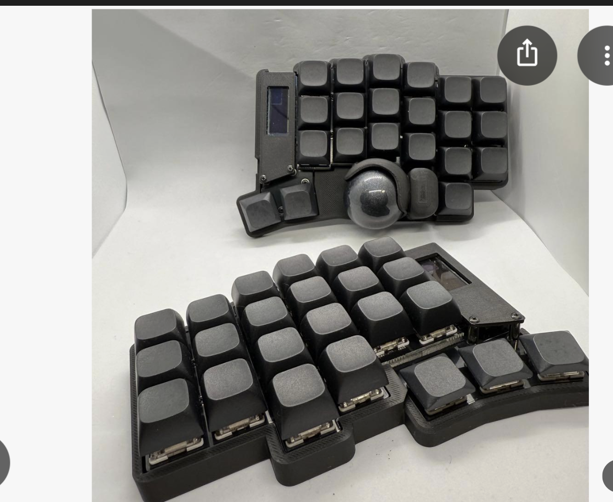
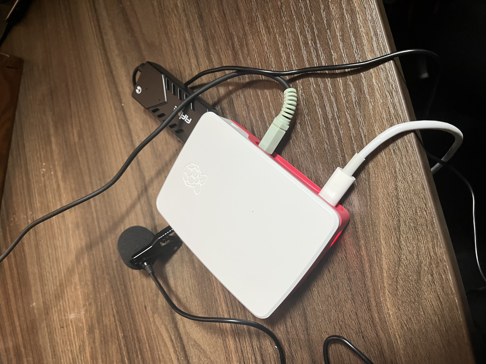
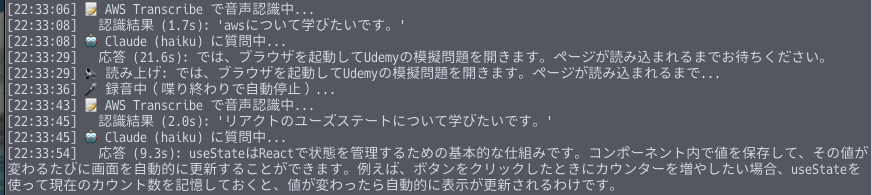
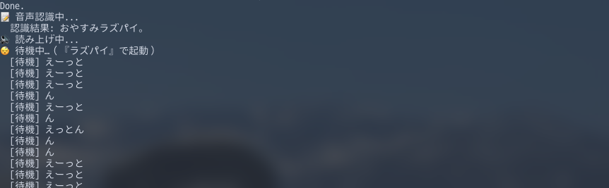
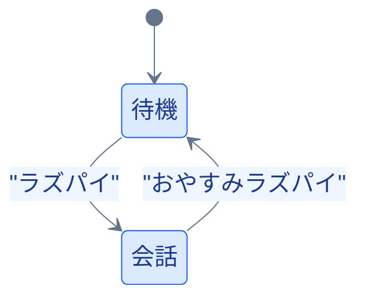
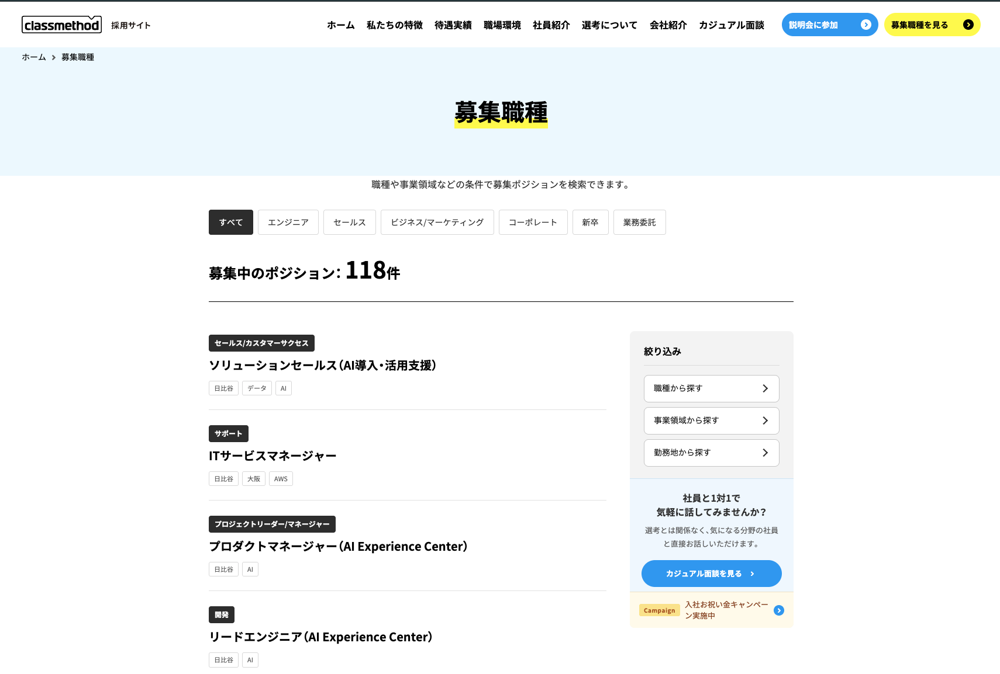
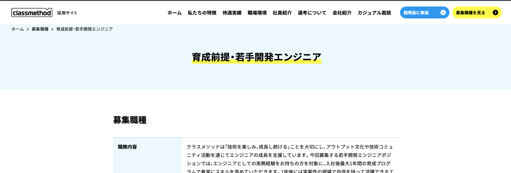

# Pi4を声で話せる相棒にしてみた

呼んだら話を聞いてくれる、机の上のラズパイ

  
    @HasutoSasaki
  

<!--
- Pi4 に話しかけると Claude Code が音声で答えてくれるデバイスを作った話
-->

---

<ProfileCard />

<!--
- Hasuto です。2026年1月からクラスメソッドでサーバーサイドを書いています
- 低レイヤーとガジェットが好きで、今回 Pi4 で遊びました
-->

---

<carbon:favorite class="inline mr-1" />ところでガジェット愛好家の皆さん

# 分割キーボードに興味があります

Keyball44 が欲しい

でも、自分でハンダ付けして組み立てる自信がなくて まだ手が出せていない…

組み立てたことある方、 コツを教えてください！

<!--
- ちょっと自己紹介の延長で、ガジェット好きとして気になっているものを
- Keyball44 という分割キーボード、前から欲しいんですが、ハンダ付けで組み立てるタイプなので自信がなくて手が出せていません
- 今日来ている皆さんで自作キーボード組んだことある方、ぜひコツを教えてください
-->

---

# 相棒の姿

Raspberry Pi 4 に話しかけると Claude Code が音声で答える

「ラズパイ」で起動、 「おやすみラズパイ」で待機に戻る

Pi4（4GB）＋ USBピンマイク ＋ 3.5mmイヤホン

<!--
- 作ったのはこれ、"声で話せる相棒"
- Pi4 に話しかけると Claude Code が音声で返してくれるデバイス
- 「ラズパイ」で起動、「おやすみラズパイ」で待機
- ハードは Pi4 にマイクとイヤホン挿しただけのシンプル構成
-->

---

最近の学び方

# なぜ作ったか

AI に聞く → 答えが返る → 終わり

便利すぎて、自分で考える力が落ちている実感があった

声に出して話すと、学びは頭に残る

いつでも呼びかけて会話できる"相棒"が欲しかった

<!--
- 最近、何か分からないことがあるとすぐ AI に聞いて、答えをもらって終わり、というループが増えていた
- 便利なんだけど、自分で考える力が落ちてる実感があった
- 振り返ると、学びが一番定着するのは自分の考えを声に出してアウトプットするとき
- Claude Code のボイスモードでも同じことはできるけど、毎回 PC 立ち上げてターミナル開くのは面倒で続かない
- いつでも声をかけたら会話が始まるデバイスが手元にあれば、学習のハードルが下がる
-->

---

# なぜ Pi4 で作ったか

  
ラズパイを触ってみたかったから

<!--
- 正直、最初は「Pi4 を触ってみたかった」が先にあった
- 用途は後付けで、話の種としてこれを作った
-->

---

# なぜ Claude Code にしたか

<carbon:notebook class="inline mr-1" />学びの蓄積先が揃っている

<code>workspace</code> リポジトリで 学びと日記を管理している

社用も私用も、話したこと・ 学んだことをここに残したい

<carbon:tool-kit class="inline mr-1" />既存資産をそのまま使える

普段使っている skill が そのまま効く

学習スタイル、校正、日報生成… 手に馴染んだ資産を活かせる

<!--
- なぜ API 直叩きじゃなく Claude Code なのか
- 普段から workspace というリポジトリを社用/私用の両方で使って、学びや日記を管理している
- 声で話したこと・学んだことも、そのリポジトリに自然に蓄積したい
- さらに Claude Code なら、普段使っている skill（学習スタイル、校正、日報生成など）がそのまま効く
- 既存の仕組みに乗れるのが最大の理由
-->

---

<carbon:education class="inline mr-1" />動いてるところ ①

# 学びの相棒として

  

「React の useState について学びたい」

→ Claude が例え付きで解説

<!--
- 学びの相棒として使っている例
- 「React の useState について学びたいです」と話しかけたら、Claude が具体例を交えて解説してくれた
- 声で聞いて、声で返ってくる。この往復が頭に残るというのを狙っている
-->

---

<carbon:moon class="inline mr-1" />動いてるところ ②

# 待機モードに戻る

  

「おやすみラズパイ」 → 待機復帰

待機中も Vosk が「えーっと」など環境音を拾っている

<!--
- もうひとつの例。「おやすみラズパイ」で待機モードに戻ったところ
- 待機中も Vosk が環境音を拾い続けている（「えーっと」「ん」など）
- ウェイクワード以外は無視するので、AWS 課金は発生しない
-->

---

# ざっくり技術スタック

<carbon:chat class="inline mr-1" />ウェイク検出

Vosk

ローカル音声認識

<carbon:headphones class="inline mr-1" />音声 → テキスト

AWS Transcribe

クラウドSTT

<carbon:machine-learning-model class="inline mr-1" />AI応答

Claude Code

<code>-p --model haiku</code>

<carbon:volume-up class="inline mr-1" />テキスト → 音声

Amazon Polly

クラウドTTS

<!--
- ざっくり使った技術の紹介
- ウェイクワード検出は Vosk（ローカル）、常時聞いてるけど課金なし
- 会話モードでは Transcribe で音声→テキスト、Claude Code で応答生成、Polly で音声化
- クラウドに頼ることで Pi4 の CPU 負荷を抑えた構成
-->

---

# 動作：待機 と 会話 の2モード

待機中はローカル Vosk のみ/会話中の質問ごとに AWS を呼ぶ

<!--
- 状態機械で組み立てた
- 待機中はローカル Vosk だけ動かして課金ゼロ
- ウェイクワードで会話モードに入り、質問するたびに AWS パイプラインが走る
- これで常時起動でも AWS 料金を最小化できる
-->

---

# 技術選定：ローカルは遅かった

<carbon:headphones class="inline mr-2" />音声認識

whisper.cpp — 16秒

Transcribe — 1.4秒

<carbon:volume-up class="inline mr-2" />音声合成

VOICEVOX — 17〜30秒

Polly — 0.1秒

Pi4 の CPU では厳しい。割り切って AWS に任せる

<!--
- 最初はローカル完結を目指したが Pi4 の CPU だと遅すぎた
- STT 約11倍、TTS 100倍以上の高速化
- 潔くクラウドに任せる判断
-->

---

# 計測してから速くする

27秒 → 13秒

体感では「AIが遅い」と思っていたが…

計測したら STT が一番遅かった

whisper.cpp 16秒 → Transcribe に切り替えて 1.4秒

<!--
- 約52%短縮
- 体感では「AIが遅い」と思っていたが、計測したら一番遅かったのは STT
- whisper.cpp が16秒で全体の半分以上を占めていた
- そこで Transcribe に切り替えたら 1.4秒、全体が一気に速くなった
- 思い込みで最適化しない、まず計測する
-->

<!--
ハマりどころスライド（時間に余裕があれば復活させる）
Slidev が --- をスライド区切りとして解釈するので、復活時は復元して slide separator を足す

=== ハマりどころ ===

・Polly の音声が HDMI から出てしまう
  → 出力先を aplay に切り替え、最終的に Polly から PCM 直接受信

・Vosk が同じ発話を別表記で返す
  → "ラズパイ" / "ラズ パイ" / "らずぱい" を全部受け入れる

・起動時の Polly 失敗でサービス全落ち
  → try/except で包んで、失敗してもログを出して継続

Speaker notes:
- Polly の音声が HDMI から出てしまった。デフォルト出力先が HDMI だった
- Vosk は同じ「ラズパイ」でも「ラズ パイ」「らずぱい」など複数パターンで返ってくる。判定側で全部許容
- 起動直後にネットワークが安定していないと Polly が失敗してサービス全体が落ちた。例外を握って継続するように修正
-->

---

# 次の一手：`claude -p` → SDK 化

現状：<code>claude -p</code>

毎回プロセス起動で 8秒 ロス

会話履歴も残らない

次：Python SDK 直叩き

常駐プロセスから API → 起動コスト ゼロ

<code>messages</code> 配列で履歴を自分で管理

応答 13秒 → 5秒 以下を狙える見込み

<!--
- 現状の最大の残課題は Claude Code の起動オーバーヘッド
- claude -p は毎回 Node のランタイムを立ち上げているので、8秒の定額コストがかかる
- しかも毎回プロセスが新しいので、前の会話を引き継げない
- Python SDK を使えば、常駐している main.py から直接 API を叩ける。起動コストはゼロ
- API はステートレス設計なので、会話履歴は messages 配列で自分で管理すれば、前の質問を踏まえた対話もできる
- これで応答時間が 13秒 → 5秒程度まで縮まる見込み
-->

---
layout: statement
---

# 実用？微妙

# でも楽しい

<!--
- スマホのClaude アプリの方が速いし便利
- でも「呼びかけたら起きる机の上のデバイス」はスマホでは出せない手触り
- ガジェットは実用じゃなくて体験を作るもの
-->

---

# 宣伝：仲間を探しています

<carbon:user-multiple class="inline mr-1" />絶賛大募集中

118件 の募集ポジション

<carbon:user-favorite class="inline mr-1" />私が入った枠

育成前提・若手開発エンジニア

この枠で入った一人担当です。声かけてください！

<!--
- 最後に宣伝
- クラスメソッド、いま 118件 募集してます
- 私が入ったのは「育成前提・若手開発エンジニア」枠で、入社後最大1年間の育成プログラム付き
- この枠で入った一人担当なので、仲間を探しています
- ガジェット好き、低レイヤー好きの方、ぜひ声かけてください
-->

---
layout: statement
---

# ありがとうございました

  
詳細記事: <a href="https://dev.classmethod.jp/articles/pi4-voice-ai-assistant/">Raspberry Pi 4で音声AIアシスタントを作ってみた - DevelopersIO</a>

<!--
- ありがとうございました
- 詳細は DevelopersIO の記事に書いてあります
-->
