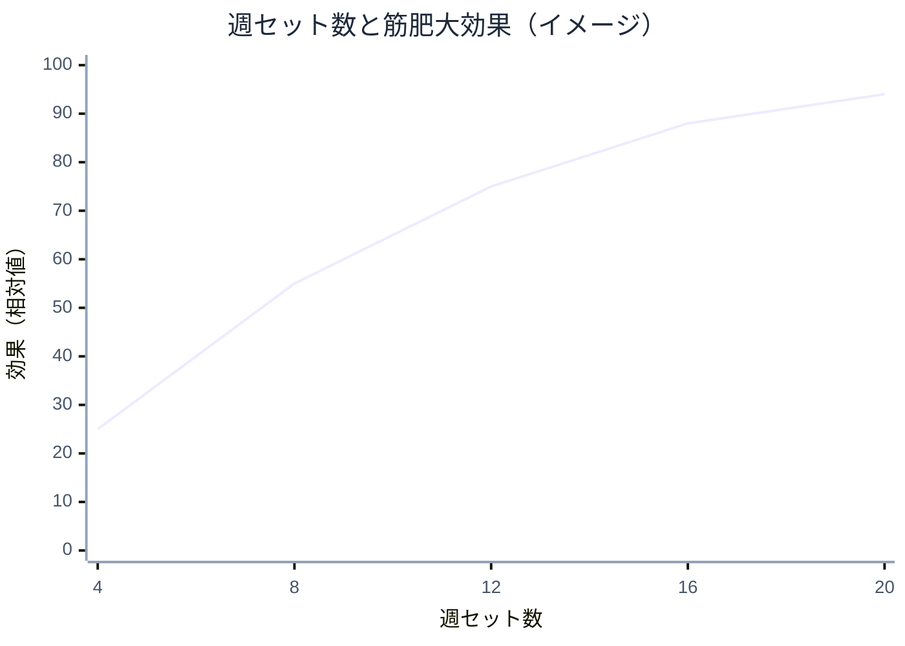

# 筋トレをリファクタリングしてみた
科学で見直す「セット数」と「部位分け」

  
    @HasutoSasaki
  

<!--
- 「筋トレをリファクタリングしてみた」というタイトルですが、難しい技術の話ではなく趣味の筋トレの話です
- これまで何となく続けていたメニューを、調べて組み直した話をします
-->

---

<ProfileCard />

<!--
- Hasuto です。趣味は筋トレです
- 今日はその筋トレのメニューを見直した話をします
-->

---

# 何となく続けていたメニュー

なぜこの種目数か、なぜこのセット数か、なぜ1日にまとめるか

「なぜ20セットなのか」と聞かれると、きちんと説明できなかった

<!--
- 胸の日は4種目×5セットの合計20セットをよく行っていた。筋肉も付いていたので無意味ではない
- ただ「なぜ20セットなのか」と聞かれると説明できなかった。3セットは少ない気がする、5セットはやりきった感じがする、くらいの感覚で決めていた
- そこでセット数や部位分けについて、論文やガイドラインを調べた
-->

---

# 筋肉はどうやって大きくなる？

トレーニングで筋肉へ刺激を与える 
<carbon:arrow-down class="inline text-blue-600" /> 
食事・睡眠・休養 
<carbon:arrow-down class="inline text-blue-600" /> 
回復して適応し、長期的に筋肉が大きくなる

今日扱うのは「刺激の与え方」

<!--
- 筋肉を付けるには、刺激・栄養・回復・継続が必要
- 前回のLTでは栄養（タンパク質・鶏むね肉）の話をした。今回はその前段にある「刺激をどう与えるか」に絞る
- 健康維持や最大筋力、競技力向上では最適な組み方が異なる場合がある。痛みやけががある場合はセット数の調整より安全を優先する
-->

---

# 主人公は「セット数」

<h3 class="opacity-100 text-xl font-700 mb-2">単位</h3>

1回持ち上げる → 1レップ

10回連続 → 1セット

限界の数回手前まで → ハードセット

<h3 class="opacity-100 text-xl font-700 mb-2">RIR = あと何回できたか</h3>

RIR 3　あと3回

RIR 2　あと2回

RIR 1　あと1回

RIR 0　もう上がらない

今日は、概ね RIR 1〜3 まで行ったセットを数える対象とする

<!--
- 軽い重量で楽に終えたセットと、限界2回手前のセットでは刺激が違う。同じ1セットとして数えるのは危険
- 筋肥大は限界に近いほど大きくなる傾向はあるが、正確な最適RIRには不確実性が残る（Robinson et al. 2024）
- 毎セット完全な限界まで行くことが必須とは示されていない（Grgic et al. 2022）
- 私が以前「20セットやった」と言っていても、20セットすべてが同じ質だったとは限らない
-->

---

# 私が行っていたメニュー
## 4種目 × 5セット = 20セット

| 種目 | セット |
|---|---:|
| ベンチプレス | 5 |
| インクラインプレス | 5 |
| チェストプレス | 5 |
| フライ | 5 |
| **合計** | **20** |

「たくさんやった方が効きそう」

<!--
- これが以前の胸の日。5セットずつ4種目、合計20セット。終わる頃には胸がパンパンで、達成感はある
- ただ、疲れたことと筋肉を効率よく成長させられたことは同じなのか、という疑問が出てきた
- なぜ5セットずつなのか考えても、根拠は「感覚」だった。まず研究上セット数を増やす意味自体を調べた
-->

---
layout: statement
---

# セット数は、本当に重要なのか？

<!--
- ここから研究の話に入る
-->

---
layout: fact
---

# 週 約10セット
ACSM 2026: 筋肥大の目安は1筋群あたり週約10セット

Currier et al., ACSM Position Stand, Medicine & Science in Sports & Exercise, 2026（137件のレビュー・3万人超を統合）

<!--
- Schoenfeldら2017年のメタ分析で、週セット数が多い条件ほど筋肥大が大きい傾向が示された
- 2026年、ACSMがレジスタンストレーニングのポジションスタンドを更新し、筋肥大の目安として週約10セット/筋群を示した
- 1回10セットではない、10セット未満では成長しないという意味でもない、10セットが全員の最適値という意味でもない
- 研究でよく扱われるのは「1週間の合計」。今日どれだけやったかより、週にどれだけ配ったかで考えるべきだと気づいた
-->

---

# 多いほど伸びやすい
## ただし、追加効果は小さくなる

収穫逓減：セットを増やすほど、追加1セットの効果は小さくなる

<!--
- Pelland et al. 2025のメタ回帰でも、週セット数が増えるほど筋肥大が伸びる傾向は確認されたが、単純な比例ではない
- 週4→8と週16→20、どちらも+4セットだが同じだけ効果が増えるとは限らない。時間・疲労・関節負担というコストも増える
- 「20セット目から突然効果がなくなる」わけではない。20セットで伸びる人もいる。20セットが間違いなのではなく、何となく固定していたことを見直す必要があった
-->

---

# ボリューム・ランドマーク

Mike Israetel らが広めた、個人ごとに変わる範囲の考え方

<h3 class="opacity-100 text-xl font-700 mb-2 text-blue-600">MEV</h3>
成長が始まる最低有効量

<h3 class="opacity-100 text-xl font-700 mb-2 text-blue-600">MAV</h3>
成長と疲労のバランスが良い範囲

<h3 class="opacity-100 text-xl font-700 mb-2 text-blue-600">MRV</h3>
回復できる最大量

研究から直接決まる厳密な数値ではなく、成長と回復を見ながら量を調整するための考え方

<!--
- セット数を一つの固定値ではなく、個人によって変わる範囲として考えるモデル
- 医学的な検査値ではなく、実践経験をもとにした目安である点は強調しておく
-->

---
layout: statement
---

# 週20セットと、1回20セットは、同じなのか？

<!--
- ここが今回最も大きかった勘違い
-->

---

# どちらも週20セット

<h3 class="opacity-100 text-xl font-700 mb-2">1日に集中</h3>

20

日曜日にまとめて

<h3 class="opacity-100 text-xl font-700 mb-2">2日に分ける</h3>

10 + 10

月曜日・木曜日

頻度は、週のセット数を分けて行うためにも使える

<!--
- 週の合計は同じ。では週2回に分ければ必ず筋肉が大きくなるのか、というとそこまで単純ではない
- 2019年のメタ分析: 週の総セット数が同じなら頻度そのものが筋肥大へ与える影響は小さい
- 2024年のメタ分析: 全身法と部位分けも、週セット数が同じなら筋力・筋肥大に明確な差はない
- つまり週2回や部位分けそのものに特別な筋肥大効果があるわけではない
-->

---

# 1回に詰め込むと品質が落ちる

<h3 class="opacity-100 text-xl font-700 mb-2">20セット後半に起きがちなこと</h3>

使用重量が落ちる、回数が落ちる、可動域が狭くなる、狙っている筋肉以外で補いやすくなる、集中力・関節の疲労が増える

週のセット数を複数日に分けると、毎回比較的元気な状態で取り組みやすくなる

1回のセット数にも収穫逓減がありそうという補足情報あり（Remmert et al. 2025, 査読前プレプリント）

<!--
- もちろん個人差はある。1回20セットでも最後まで高い質で行えて、重量や回数が伸びている人もいる
- 「10セットずつに分ければ必ず優れている」とまでは言えない
- 私の場合は20セット後半で重量や集中力が落ちている感覚があったため、1回のセット数を減らして別の日にも行うことにした
-->

---
layout: statement
---

# メニューを見直す

<!--
- ここから実際に見直した内容
-->

---

# 見直したメニュー
## 1回20セットから、週16セットを2回に分ける

<h3 class="opacity-100 text-xl font-700 mb-2">これまで</h3>

| 項目 | 内容 |
|---|---|
| 頻度 | 週1回 |
| 1回のセット数 | 20 |
| **週合計** | **20** |

<h3 class="opacity-100 text-xl font-700 mb-2 text-blue-600">これから</h3>

| 項目 | 内容 |
|---|---|
| 頻度 | 週2回 |
| 1回のセット数 | 8 |
| **週合計** | **16** |

週16セットは正解ではなく、<b>自分に合う量を探すための出発点</b>

<!--
- 理由は3つ。1: ACSMの週約10セットという目安を満たす。2: これまで週20セット近く行っていたため急に大幅に減らさず比較できる。3: 20セットから少し減らすことで重量・回数・回復の変化を確認しやすい
- 1種目を必ず5セット行うのではなく、まず2〜3セットを集中して行う。後半に惰性で続けるセットを減らし、毎セットで重量・回数・フォームを保つことを重視する
- 各セットは概ねRIR1〜3、ウォームアップは週セット数に含めない、同じ部位を鍛える日は2〜3日空ける、胸のプレス種目は三頭筋や肩の前側にも刺激が入る
-->

---

# 6〜8週間、記録して確認する
## 自分に合う量は、結果を見ながら探す

<h3 class="opacity-100 text-xl font-700 mb-2">記録する項目</h3>

重量・回数・RIR、後半の回数低下、筋肉痛・関節の違和感、睡眠・体調

伸びている → そのまま続ける

伸びない + 回復に余裕 → 週2セットほど増やす

伸びない + 疲労が強い → 週2〜4セット減らす

その日のパンプではなく、数週間後の重量・回数という長期的な結果で判断する

<!--
- メニューを変えただけでは良くなったか分からない。新しい週16セットのメニューを6〜8週間続けて記録する
- パンプが強いとよく効いた気がするが、本当に見たいのは数週間後に重量や回数が伸びたか、無理なく継続できたかという長期的な結果
- 「少なくて不安だから増やす」のではなく、成長と回復の記録を見て増減する
-->

---
layout: statement
---

# まとめ

<!--
- 最後にまとめる
-->

---

# セット数には、考え方がある

<h3 class="opacity-100 text-xl font-700 mb-2">これまで</h3>

1日に20セット。何となく5セットずつ

<h3 class="opacity-100 text-xl font-700 mb-2 text-blue-600">これから</h3>

週12〜16セット付近から確認。複数日に分け、成長と回復を見て増減

セット数は、多ければよいのではなく、自分に合わせて調整する

<!--
- 筋肥大にはある程度のセット数が必要だが、増やすほど追加効果は小さくなる。20セット目から効果がなくなるわけではないが、本当に必要かは考える必要がある
- 週1回か週2回か、全身法か部位分けかという方法自体に特別な筋肥大効果があるわけではない。生活や回復に合わせて選ぶ
- 全員に共通する完璧なセット数があるのではなく、研究を出発点に自分の成長と回復を見て調整することが大切。これまで何となく続けていたメニューを一度整理して組み直した、それが今回のタイトルの意味
-->

---
layout: statement
---

# ありがとうございました

<!--
- ありがとうございました
-->
