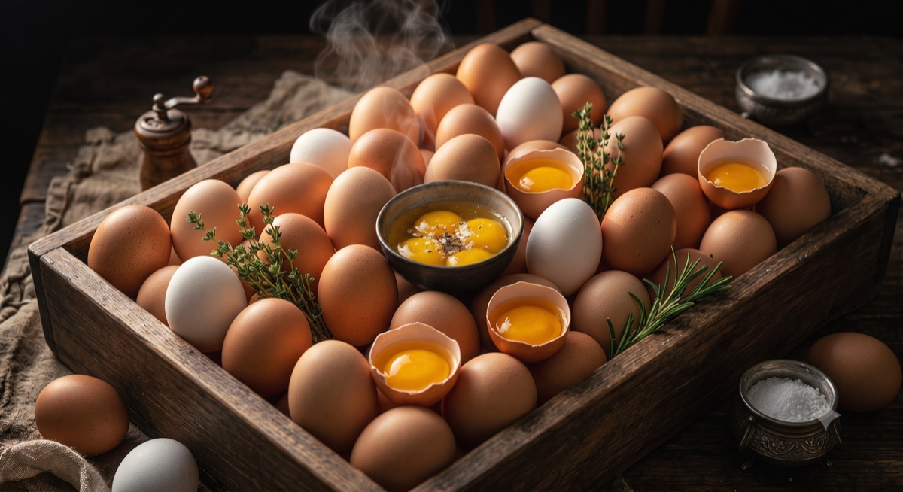
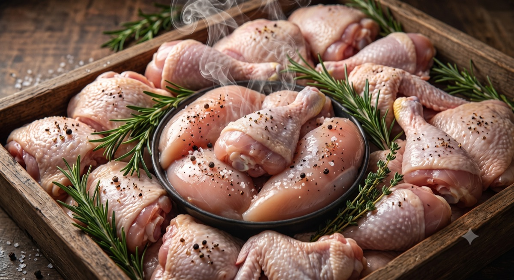
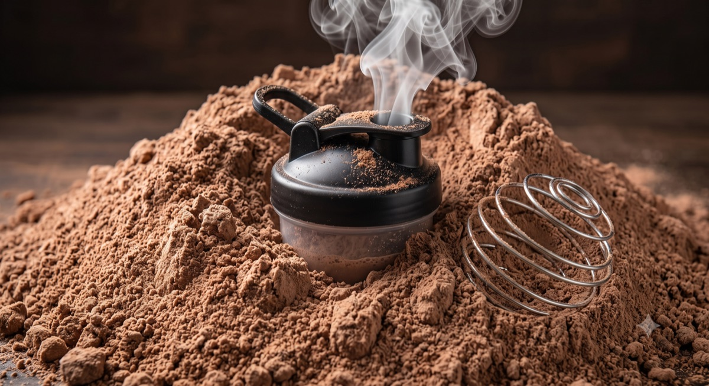

<!--
生成画像はすべて slides/why-chicken-breast/image-prompts.md のプロンプトを使って用意し、
public/images/ または assets/images/ 配下に同名で配置すると自動的に反映される。
-->

---
layout: intro
---

# トレーニーはなぜ鶏むね肉を食べ続けるのか

筋肉、その見えない設計思想

<!--
- トレーニーと聞くと何を思い浮かべますか？ 鶏むね肉、プロテイン、ゆで卵
- 「好きだから食べている」という説を今日は検証します
-->

---
layout: statement
clickAnimation: fade-in.up
---

彼らは、今日も鶏むね肉を食べる。 昨日も。 おそらく明日も。

好きだからではない。

そこには、ある「数字」が隠されていた。

<!--
- ここはナレーション口調で、1クリックごとに3秒ほど間を置いてから次を読む
- 「好きだからではない」は一段大きく強く読む
- 「今日はその数字の話です」で本編に入る
-->

---

<ProfileCard />

<!--
- Sasaki Hasuto です
- classmethod で Web アプリ開発をしています
-->

---

## 本当に好きで食べてるの？

<h3 class="opacity-100 text-xl font-700 mb-2">一般的なイメージ</h3>

「筋トレにハマると鶏むね肉ばかり食べるようになる」

<h3 class="opacity-100 text-xl font-700 mb-2">今日の結論</h3>

？？？

<!--
- 実は好きだからではありません
- 今日は数字だけで説明します
-->

---
layout: fact
---

# 1.6〜2.2g/kg
体重70kgなら、1日112〜154g必要

<!--
- 筋トレする人はこれだけのタンパク質が必要と言われている
- 出典: Morton et al. 2018 メタアナリシス（飽和点1.62g/kg）、ISSN Position Stand 2017（1.4〜2.0g/kg）
- この数値の根拠は2017〜2018年の文献だが、2022年の新しいメタアナリシスでも約1.5g/kgで頭打ちという近い結論が出ており、繰り返し検証されて生き残っている値
- じゃあこれってどのくらいの量なのか、次のスライドで見せる
-->

---

## 112gってどれくらい？

  
  <h3 class="opacity-100 text-lg font-700 mt-3">卵換算</h3>
  
18〜25個

  
  <h3 class="opacity-100 text-lg font-700 mt-3">鶏むね肉換算</h3>
  
約500〜650g

  
  <h3 class="opacity-100 text-lg font-700 mt-3">プロテイン換算</h3>
  
約4〜5杯

<!--
- 毎日ゆで卵20個生活は、かなりニワトリ寄りです
- ここで初めて、鶏むね肉という選択肢が現実味を帯びてくる
-->

---
layout: statement
clickAnimation: fade-in.up
---

トレーニーはプロテインが好きなんじゃありません。

鶏むね肉だけで毎日150gのタンパク質を摂る生活を、 一週間だけ想像してください。

たぶん、2日目にはプロテインを買いに行きます。

<!--
- ここが一番伝えたい一言
- 150gは体重70kgの必要量112〜154gの範囲内、誇張ではなく実際の数字
- 最後の1行はオチなので、少し間を置いてから読む
-->

---

## よくある誤解① タイミング神話

<h3 class="opacity-100 text-xl font-700 mb-2">思われていること</h3>

「運動後30分以内に飲まないと意味がない」

<h3 class="opacity-100 text-xl font-700 mb-2">実際は</h3>

総摂取量の方が重要

Casuso &amp; Goossens, Nutrients 2025

<!--
- 筋タンパク質合成は運動後24〜48時間持続する
- 過去に「タイミング効果あり」とされた研究は、実は総摂取量も群間で違っていた
-->

---

## よくある誤解② 腎臓への影響

<h3 class="opacity-100 text-xl font-700 mb-2">思われていること</h3>

「タンパク質の摂りすぎは腎臓に悪い」

<h3 class="opacity-100 text-xl font-700 mb-2">実際は</h3>

健康な人には根拠なし

既往の腎疾患がある人は別

Devries et al., J Nutr 2018

<!--
- 健康な人と腎疾患がある人の混同が誤解の元
-->

---
layout: image-right
image: /images/house-construction.jpg
---

## よくある誤解③
### 「ご飯を多く食べればよくない？」

筋肉を「家」に例えると

- タンパク質 = 材料
- 炭水化物 = エネルギー
- 電気だけあっても家は建たない
- 材料だけあっても職人が動けない
- だから両方必要

<!--
- 炭水化物・脂質は炭素・水素・酸素のみで構成されるエネルギー源
- アミノ酸は窒素を含むのが本質的な違い。必須アミノ酸9種は体内で合成できない
- 炭水化物をいくら摂っても、筋肉の材料である窒素は補充されない
-->

---
layout: fact
---

# +1.2kg vs +0.1kg
同じ運動・同じカロリー制限。違いはタンパク質量だけ。

<!--
- Longland et al. 2016（AJCN）
- 40%カロリー欠損・同じ運動メニューで、タンパク質量だけ2.4g/kg vs 1.2g/kgに分けた4週間の介入
- 高タンパク群は除脂肪体重+1.2kg、低タンパク群は+0.1kg
- カロリーだけでは説明できませんでした
-->

---
layout: bullets
---

# 今日伝えたかったこと

* 必要量は意外と多い
* だから鶏むね肉になる
* だからプロテインになる
* 都市伝説も意外と多い

---
layout: intro
---

# トレーニーはなぜ鶏むね肉を食べ続けるのか

<!--
- タイトルを再掲して3秒間を置く
-->

---
layout: statement
---

# 好きだからではない。
# 数字に従った結果だった。

---
layout: fact
---

# 1.6〜2.2g/kg
答えは、これだけだった。

<!--
- 最初に見せた数字がもう一度出てくる、という一本の線の締め
-->

---
layout: quote
---

# 筋肉は気合いではなく、エビデンスでできている。
