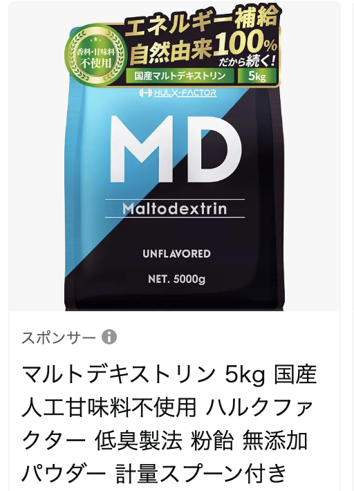

# トレーニーはなぜ怪しい粉を飲むのか
マルトデキストリンを飲み始めた話

  
    @HasutoSasaki
  

<!--
- 以前「トレーニーはなぜ鶏むね肉を食べ続けるのか」という話をしましたが、今日はその続きです
- 今日は「粉」の話をします
-->

---

<ProfileCard />

<!--
- Hasuto です。趣味は筋トレです
- 今日も筋トレの話をします
-->

---

# 困ったことに、粉が増える

プロテイン、EAA、BCAA、クレアチン、HMB 
気づくと棚が白い粉だらけになる

今日はその中の1つ、最近飲み始めた粉の話

<!--
- 筋トレを続けていると、困ったことに家の粉が増えていきます。プロテインから始まって、EAA、クレアチンと増えていきました
- 傍から見るとかなり怪しい棚ができあがります
- 今日はその中の1つ、最近飲み始めた粉の話をします
-->

---

# 仕事終わりのジムは、いつもガス欠

普段は仕事が終わった夕方にジムへ行く。その時点でエネルギーが残っていない

<h3 class="opacity-100 text-xl font-700 mb-2">団子を食べる</h3>

手軽に糖質を摂れる

<h3 class="opacity-100 text-xl font-700 mb-2">エナドリを直前に飲む</h3>

糖分とカフェインで気合いを入れる

とりあえず何か入れてから始めていた

<!--
- 私は仕事終わりの夕方にジムに行くことが多いのですが、その時点でエネルギーが切れています
- なので餅を食べたり、エナジードリンクを直前に飲んだりして、とりあえず何か入れてから始めていました
-->

---

# それでも、後半で力が落ちる

<h3 class="opacity-100 text-xl font-700 mb-2">トレーニング序盤</h3>

力が出て、いつも通り挙がる

<h3 class="opacity-100 text-xl font-700 mb-2">セット後半・終盤</h3>

徐々に力が落ちて、重量も回数も伸びない

糖分を入れているはずが、最後まで持たない

<!--
- ところが、トレーニングの序盤は力が出るのに、後半やセットの終わりになると明らかに力が落ちていきます
- 何か入れているのに最後まで持たない。ここをずっと悩んでいました
-->

---
layout: statement
---

# 本日の主役 マルトデキストリン

とうもろこし由来の、安全な粉です。

<!--
- そこで出会ったのが、今日の主役、マルトデキストリンです
- 名前は怪しいですが、正体はとうもろこしのでんぷんから作られる糖質です
- なぜこれが答えになるのか、順番に話します
-->

---

# そもそも、筋トレは糖を使う

筋グリコーゲン = 筋肉の中に貯めてある糖。筋トレの燃料になる

筋トレは短時間で大きな力を出す運動 
<carbon:arrow-down class="inline text-blue-600" /> 
主に働くのは「解糖系」= 糖を使う経路 
<carbon:arrow-down class="inline text-blue-600" /> 
1回のトレーニングで筋グリコーゲンは24〜40%減る

足りなくなると、出せる力そのものが落ちる

<!--
- 筋トレのように短時間で最大の力を出す運動では、主に解糖系という糖を使う経路が働きます
- そのとき使うのが筋グリコーゲンです。食事で摂った糖を、筋肉の中に貯めておく形のことで、車でいえばガソリンタンクにあたります
- メタ分析では、1回のレジスタンストレーニングで筋グリコーゲンが24〜40%減ると報告されています
- グリコーゲンが少ない状態で始めると疲労が早まり、出せる力そのものが落ちます。原因は筋収縮の信号伝達（興奮収縮連関）の乱れとされています
- 糖質摂取の効果は「空腹の状態」「10セットを超えるようなボリューム」で出やすいという報告もあり、まさに仕事終わりのトレーニングが当てはまります
- 出典: Hamidvand et al. 2025（Physiological Reports）、糖質摂取と筋力トレーニングのシステマティックレビュー（PMC8878406）
-->

---

# 餅とエナドリに足りなかったもの

<h3 class="opacity-100 text-xl font-700 mb-2">餅</h3>

固形なので消化に時間がかかる。直前に食べても間に合わない

<h3 class="opacity-100 text-xl font-700 mb-2">エナドリ</h3>

糖質量はそこそこある。ただし濃度が高く、胃に残りやすい

足りなかったのは量ではなく、胃をすぐ通り抜ける形

<!--
- 餅は固形なので消化に時間がかかり、直前に食べてもトレーニング中には間に合いません
- エナドリは液体で糖質量もそれなりにあります。モンスター355mlで約39g、レッドブル250mlで約27g。ただし糖の濃度が高い飲み物は、胃から出ていくのが遅くなります
- つまり足りなかったのは糖の量というより、胃をすぐ通り抜けて間に合ってくれる形の糖でした
- 「運動30〜60分前の高GI摂取で反応性低血糖が起こる」という話もありますが、実際にパフォーマンスが落ちたと示す研究は多くないため、原因として断定はしません
-->

---

# なぜマルトデキストリンなのか

胃は中身の「濃さ」を見て、送り出す速さを決めている

<h3 class="opacity-100 text-xl font-700 mb-4">砂糖・ブドウ糖</h3>

    

    

    

    

    

    

    

    

粒がバラバラで数が多い = 濃いと判定され、胃に残りやすい

<h3 class="opacity-100 text-xl font-700 mb-4">マルトデキストリン</h3>

  

      

      

      

      

      

      

      

    

  

      

      

      

      

      

      

      

    

糖の量は同じでも、つながっているので粒は少ない = 薄いと判定される

つながっているだけで、胃を速く通り抜けられる

<!--
- ここが今日の一番の話です。胃は中身の濃さ、専門的には浸透圧を見て、送り出す速さを決めています
- 砂糖やブドウ糖は、溶かすと粒がバラバラになります。糖の量が同じでも粒の数が多いので、胃は「濃い」と判定して、ゆっくりしか送り出しません
- マルトデキストリンは、ブドウ糖が数珠のようにつながった状態です。糖の総量は同じでも粒の数は少ないので、胃は「薄い」と判定して速く送り出します
- 速く胃を通り抜けて小腸に届くので、トレーニング前に飲んでも間に合います。これがエナドリや餅との決定的な違いです
- 加えて甘みが砂糖の8〜10分の1程度なので、量を溶かしても飲み切れます
- 出典: 胃排出と浸透圧の比較研究（PMC9502814）、Gastric Emptying During Exercise（NCBI Bookshelf NBK231135）
-->

---

# どう飲むか

<h3 class="opacity-100 text-xl font-700 mb-2">前</h3>

グリコーゲンを蓄えておく。1〜2時間前が目安

<h3 class="opacity-100 text-xl font-700 mb-2">中</h3>

薄めて少しずつ飲み、枯渇を防ぐ

<h3 class="opacity-100 text-xl font-700 mb-2">後</h3>

インスリンが出て、筋肉に栄養が届きやすくなる

目安は体重×1g。一度に濃く溶かさないのがコツ

<!--
- 理想は前・中・後の3回とされています。前は蓄えるため、中は枯渇を防ぐため、後は回復を早めるため
- 私自身は基本的に「前」だけです。ジムに向かう前に溶かして飲んでいます
- 量の目安は体重×1g程度。ただし一度に濃く溶かすと結局胃に残るので、そこだけ注意です。パッケージの推奨量も参考にしてください
- 出典: Myprotein「マルトデキストリンの効果と摂取量、タイミング」
-->

---

# いいことばかりではない

<h3 class="opacity-100 text-xl font-700 mb-2">血糖の振れが大きい</h3>

GI値は95〜136で、砂糖（65）より高い。運動と関係なく飲めば、ただの高GI糖質

<h3 class="opacity-100 text-xl font-700 mb-2">結局はカロリー</h3>

糖質なので減量期には不利。飲みすぎるとお腹をこわすこともある

食事でしっかり糖を摂れているなら、そもそも要らない

<!--
- デメリットも正直に話しておきます。マルトデキストリンのGI値は95〜136とされ、砂糖の65より高い。運動と関係ないタイミングで飲めば、ただの吸収の速い糖質です
- 当然カロリーもあるので、減量期には不利に働きます。飲みすぎると胃腸の不調や低血糖につながる可能性もあります
- そもそもトレーニング前に食事で糖を摂れているなら必要ありません。自分のように空腹でジムに行く人向けの解決策です
- 出典: Healthline「What Is Maltodextrin?」
-->

---

# 怪しい粉だけど、理由がちゃんとある

<h3 class="opacity-100 text-xl font-700 mb-2">これまで</h3>

餅やエナドリで、とりあえず何か入れていた

<h3 class="opacity-100 text-xl font-700 mb-2">これから</h3>

トレーニング前に、薄めた糖を入れておく

<h3 class="opacity-100 text-xl font-700 mb-2">値段</h3>

  

    
  

  
5kgで約4,000円。1回70gでも50円ほど

朝トレや仕事終わりなど、エネルギーが空のときに思い出してください

<!--
- 怪しい見た目の粉ですが、胃を速く通り抜けるという理由があって選ばれています
- 値段も、Amazonで5kg 4,000円前後です。1gあたり0.8円くらいなので、1回70g使っても50円ほど。プロテインより安い部類です
- 何を摂るかだけでなく、どういう形で摂るかで体感が変わりました
- 朝トレの人、仕事終わりでガス欠の人は、そういう選択肢があることを覚えて帰ってもらえると嬉しいです
- まだ勉強中なので、詳しい方がいたら懇親会でぜひ教えてください
-->

---
layout: statement
---

# ありがとうございました

<!--
- ありがとうございました
- 質問があれば、プロテインやEAA、BCAAとの違いも用意しています
-->
